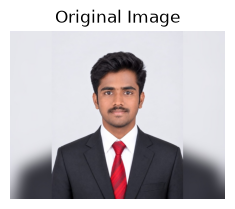
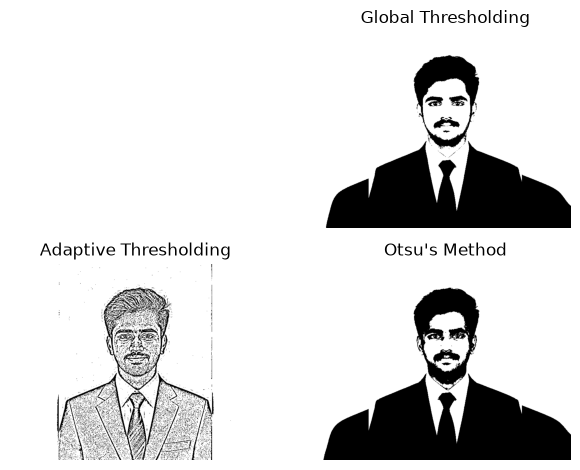

# Experiment 8 – Image Thresholding

## Name
MUTHUAKASH M

## Register Number
212225230194

## Aim
To segment an image using different thresholding techniques such as Global Thresholding, Adaptive Thresholding, and Otsu's Thresholding using OpenCV and Python.

## Software Required
- Python
- Jupyter Notebook
- OpenCV (`cv2`)
- NumPy
- Matplotlib

## Input Image Required
- `Qno. 1.jpg`

Place the input image in the same folder as the Jupyter Notebook or Python program.

## Algorithm
1. Import the required libraries: OpenCV, NumPy, and Matplotlib.
2. Read the input image using `cv2.imread()`.
3. Convert the original image from BGR to grayscale using `cv2.cvtColor()`.
4. Display the original image.
5. Apply Global Thresholding with threshold value 127 using `cv2.threshold()`.
6. Apply Adaptive Thresholding using the Gaussian method with block size 11 and constant value 2 using `cv2.adaptiveThreshold()`.
7. Apply Otsu's Thresholding using `cv2.threshold()` with `cv2.THRESH_OTSU`.
8. Display and compare the original image and the three thresholding results.

## Program 1: Import Libraries

```python
import cv2
import numpy as np
import matplotlib.pyplot as plt
```

## Program 2: Read the Image and Convert to Grayscale

```python
image = cv2.imread('Qno. 1.jpg')  # Replace with your image file path
gray_image = cv2.cvtColor(image, cv2.COLOR_BGR2GRAY)  # Convert to grayscale
```

## Program 3: Display the Original Image

```python
# Original Image
plt.subplot(2, 2, 1)
plt.imshow(cv2.cvtColor(image, cv2.COLOR_BGR2RGB))  # Convert from BGR to RGB for display
plt.title("Original Image")
plt.axis('off')
```

### Output – Original Image





## Program 4: Global Thresholding

```python
# Apply global thresholding with threshold value 127
_, global_thresholded = cv2.threshold(gray_image, 127, 255, cv2.THRESH_BINARY)
```

## Program 5: Adaptive Thresholding

```python
# Apply adaptive thresholding using Gaussian method
adaptive_thresholded = cv2.adaptiveThreshold(
    gray_image, 255, cv2.ADAPTIVE_THRESH_GAUSSIAN_C,
    cv2.THRESH_BINARY, 11, 2
)
```

## Program 6: Otsu's Thresholding

```python
# Apply Otsu's method for optimal thresholding
_, otsu_thresholded = cv2.threshold(
    gray_image, 0, 255, cv2.THRESH_BINARY + cv2.THRESH_OTSU
)
```

## Program 7: Display the Thresholding Results

```python
# Global Thresholding
plt.subplot(2, 2, 2)
plt.imshow(global_thresholded, cmap='gray')
plt.title("Global Thresholding")
plt.axis('off')

# Adaptive Thresholding
plt.subplot(2, 2, 3)
plt.imshow(adaptive_thresholded, cmap='gray')
plt.title("Adaptive Thresholding")
plt.axis('off')

# Otsu's Method
plt.subplot(2, 2, 4)
plt.imshow(otsu_thresholded, cmap='gray')
plt.title("Otsu's Method")
plt.axis('off')

# Show the plot
plt.tight_layout()
plt.show()
```

### Output – Original Image, Global Thresholding, Adaptive Thresholding, and Otsu's Method




## Result

Thus, image segmentation was performed successfully using Global Thresholding, Adaptive Thresholding, and Otsu's Thresholding techniques in OpenCV and Python. The outputs were displayed for observation and comparison.
